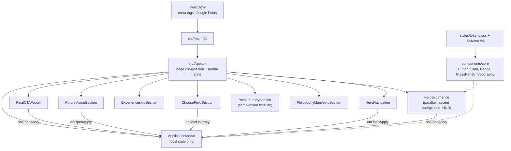

# YESA

A single-page, scroll-driven landing site for **YESA**, a free incubator concept that takes people from a first application to real-world leadership through a structured, staged path. This repository is the first version of the site.

    

## Overview

YESA describes itself (see [`index.html`](index.html)) as *"a 100% free incubator designed to help people gradually develop into future leaders through structured real-world progression. Choose your field. We provide the path."*

The site has to explain a multi-stage programme to prospective applicants without overwhelming them. It does this as one long, editorial page where scrolling literally moves the visitor up an "ascent": each section reveals the next step of the programme, and every section ends in a call to apply.

The programme as presented by the site:

1. **Application**: the beginning.
2. **Interview**: the gate.
3. **Volunteering**: an observation period of up to six months alongside active cohorts.
4. **Paid internship**: real work on real projects with senior members.
5. **Experienced**: leading teams and pioneering your own ideas.
6. **World-class leader**: the long-term aspiration, with two future paths (leadership inside organisations, or creating your own venture).

### Relationship to Yesa-2

This repository (**YESA**, built 25-26 Aug 2026) is the original version of the site. [**Yesa-2**](https://github.com/suriyaprakash-25/Yesa-2) (28-29 Aug 2026) is a redesign of the same project: both share the package name `yesa`, the same page title and the same section-based component layout. Yesa-2 adds client-side routing, a dedicated `/apply` page that actually submits applications (via Formspree), light and dark themes, concrete disciplines instead of placeholder field tracks, and image-based visuals. This version keeps everything on one page, and its application form is a front-end-only prototype.

## Key features

- **Editorial hero** with a scroll-linked parallax effect (opacity, scale and offset tied to `scrollY`), an animated "ascent" background, a progress HUD and a magnetic call-to-action button.
- **Philosophy manifesto** with interactive pillars (field of conviction, world-class foundations, cohort immersion, compensated execution, venture and autonomy) and the programme's offerings (free trainings, experience-ship programmes, and more).
- **The YESA Journey**, the centrepiece: a sticky, scroll-driven timeline of the six milestone stages. Scroll progress (`useScroll` + `useSpring`) fills the path, marks stages as completed, active or upcoming, and swaps the detail panel.
- **Choose Your Field**: five interactive field tracks, each showing the same progression (domain training, cohort observation, real-world work, world-class leadership). The tracks are intentionally generic ("Field Track 01-05") so real disciplines can be plugged in.
- **Experience-ship**: the practical evolution from volunteering and observation, through cohort synchronisation and a paid internship, to experienced pioneer.
- **Future Vision**: Learning, Building, Leading, Creating, branching into two pathways.
- **Final CTA and footer** with section navigation.
- **Application modal** collecting full name, email, chosen field (six options) and a personal vision. *Prototype*: on submit it only shows a confirmation state; nothing is sent or stored.
- **Small design system**: reusable `Button`, `Card`, `Badge`, `GlassPanel`, `Container` and `Typography` components, with tokens in [`src/styles/tokens.css`](src/styles/tokens.css) and types in [`src/types/design-system.ts`](src/types/design-system.ts).

## Architecture

The project is a purely client-side React single-page application with no backend and no routing.



| Component | Role |
| --- | --- |
| `App.tsx` | Composes the sections in order, owns the `isApplyModalOpen` state, and provides smooth-scroll navigation between section anchors (`philosophy`, `journey`, `fields`, `experience`, `future`). |
| `components/hero/` | Navigation bar, hero section, animated ascent background, progress HUD and magnetic CTA. |
| `components/philosophy/` | Manifesto pillars and offerings. |
| `components/journey/` | The six-stage scroll-driven journey and its milestone nodes and detail panels. |
| `components/fields/` | Field-track explorer with a per-track progression. |
| `components/experience/`, `components/future/` | Experience-ship stages and the future-vision branching paths. |
| `components/footer/` | Final call to action and footer navigation. |
| `components/sections/ApplicationModal.tsx` | The application form (prototype, no submission). |
| `components/core/` | Shared UI primitives used across sections. |

## How it works

1. `index.html` loads the fonts and mounts `src/main.tsx`, which renders `<App />` inside `StrictMode`.
2. `App` renders the navigation, six content sections and the footer as one continuous page.
3. As the visitor scrolls, Framer Motion's `useScroll` drives the hero parallax and the journey timeline; the journey section maps scroll progress to the active stage.
4. Every "Apply" or "Start your journey" button calls a callback passed down from `App`, which opens the `ApplicationModal`.
5. Submitting the modal validates the required fields in the browser and switches to a success view. No network request is made.

## Tech stack

| Layer | Technologies |
| --- | --- |
| UI | React 19, TypeScript |
| Build tool | Vite 8 with `@vitejs/plugin-react` |
| Styling | Tailwind CSS v4 (`@tailwindcss/vite`), CSS custom properties, `clsx` + `tailwind-merge` |
| Animation | Framer Motion (`useScroll`, `useTransform`, `useSpring`, `AnimatePresence`) |
| Icons | `lucide-react` |
| Linting | Oxlint ([`.oxlintrc.json`](.oxlintrc.json)) |

## Project structure

```text
YESA/
├── index.html                    # Page shell, SEO meta tags, fonts, inline favicon
├── src/
│   ├── main.tsx                  # React entry point
│   ├── App.tsx                   # Page composition, modal state, section navigation
│   ├── index.css, App.css        # Global styles
│   ├── styles/tokens.css         # Design tokens
│   ├── types/design-system.ts    # Shared design-system and content types
│   └── components/
│       ├── core/                 # Button, Card, Badge, GlassPanel, Container, Typography
│       ├── hero/                 # HeroNavigation, HeroExperience, AscentMetaphorBackground, AscentProgressHUD, MagneticCTA
│       ├── philosophy/           # PhilosophyManifestoSection
│       ├── journey/              # YesaJourneySection
│       ├── fields/               # ChooseFieldSection
│       ├── experience/           # ExperienceshipSection
│       ├── future/               # FutureVisionSection
│       ├── footer/               # FinalCTAFooter
│       ├── navigation/           # Header, StageTimelineNav (only used by unused drafts)
│       ├── sections/             # ApplicationModal (used) + earlier section drafts (unused)
│       ├── showcase/             # DesignSystemShowcase (unused)
│       └── visual/               # AscentVisualizer (only used by unused drafts)
├── vite.config.ts                # Vite + React + Tailwind plugins
└── package.json
```

## Getting started

### Prerequisites

- Node.js (a version supported by Vite 8; Node 20.19+ or 22.12+)
- npm

### Install and run

```bash
npm install
npm run dev        # Vite dev server, http://localhost:5173 by default
```

| Script | What it does |
| --- | --- |
| `npm run dev` | Start the Vite development server with hot reload |
| `npm run build` | Type-check (`tsc -b`) and build to `dist/` |
| `npm run preview` | Serve the production build locally |
| `npm run lint` | Run Oxlint |

No environment variables are required.

## Limitations and roadmap

- **Front-end prototype**: the application form does not submit or store anything. (Yesa-2 replaces it with a working `/apply` page.)
- Field tracks are placeholders ("Field Track 01-05") awaiting real disciplines.
- Several components are earlier drafts that `App.tsx` no longer renders: everything in `src/components/sections/` except `ApplicationModal`, plus `navigation/`, `showcase/` and `visual/`.
- `dotenv` and `node-fetch` are listed as dependencies but are not used by the source code.
- There are no automated tests.

Active development continues in [Yesa-2](https://github.com/suriyaprakash-25/Yesa-2).

## Author

Built by [Suriyaprakash](https://github.com/suriyaprakash-25).
